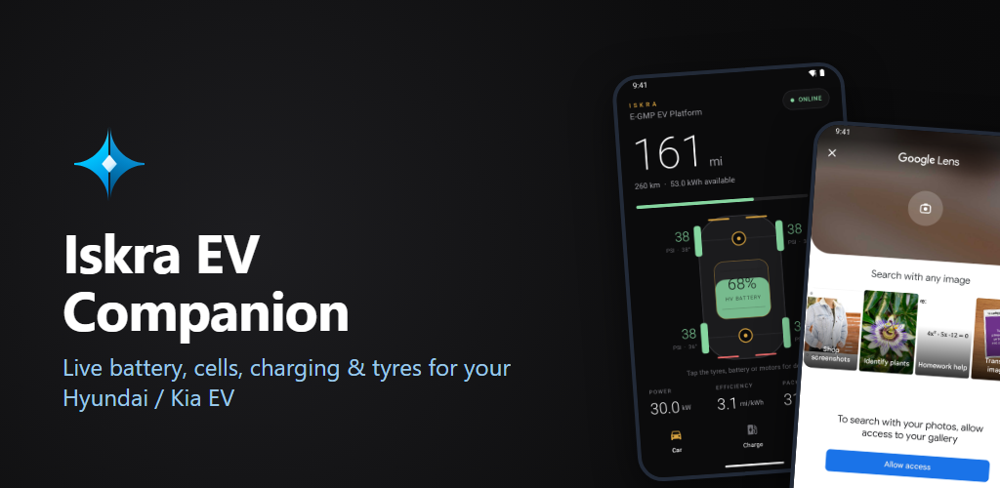
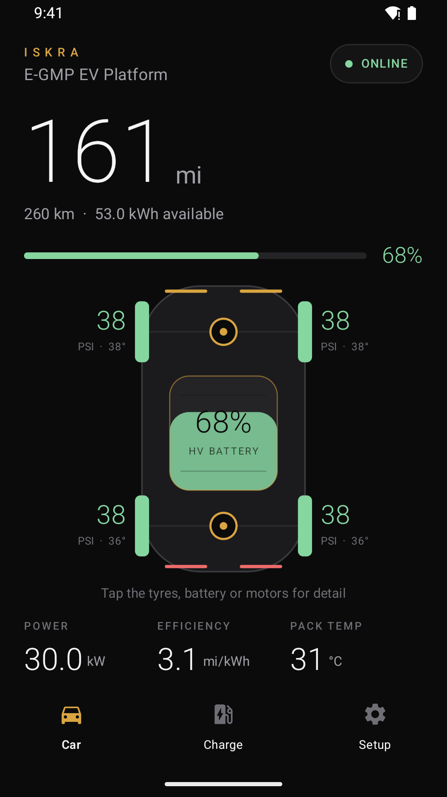
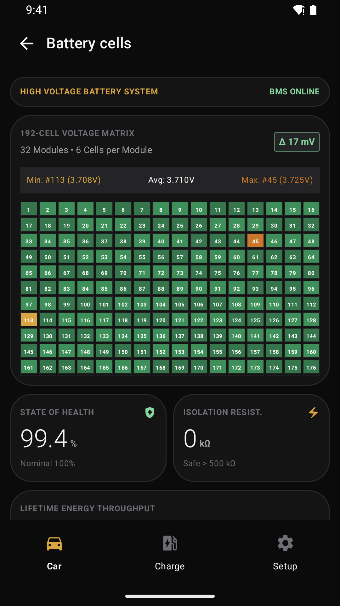
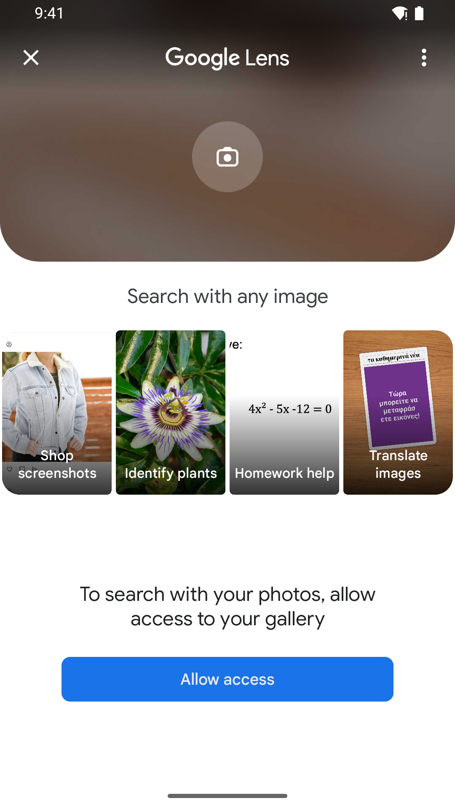
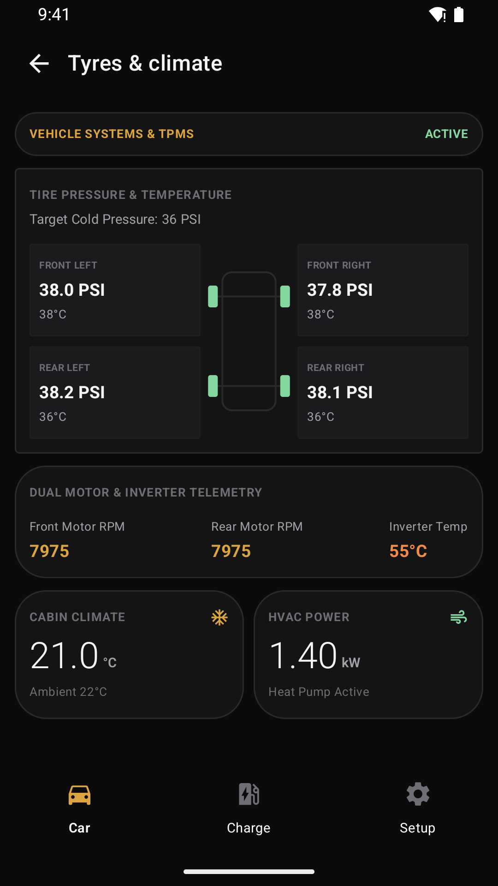
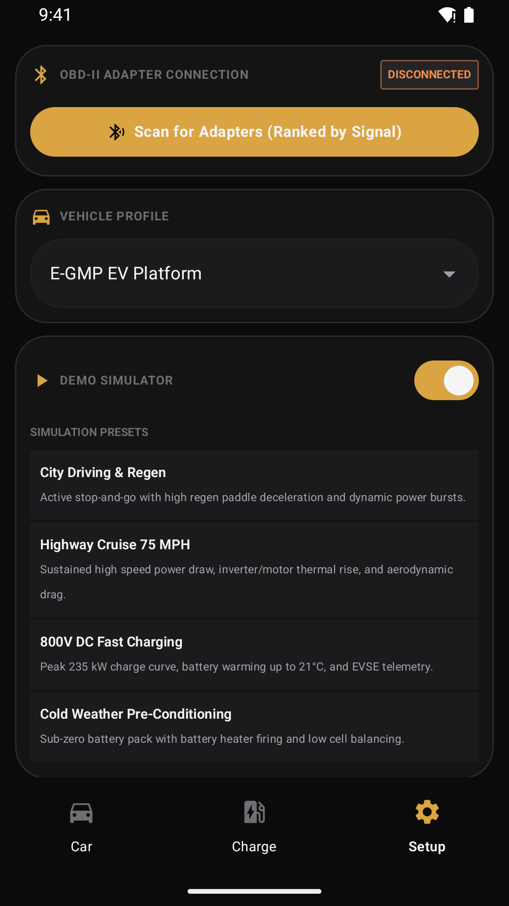

# Iskra EV Companion — Live EV Telemetry over Bluetooth OBD-II

<p align="center">
  
</p>

<p align="center">
  <a href="https://github.com/oleh11/IskraEV/releases/latest"></a>
  <a href="https://github.com/oleh11/IskraEV/releases"></a>
  <a href="https://github.com/oleh11/IskraEV/blob/master/LICENSE"></a>
  <a href="https://developer.android.com/jetpack/compose"></a>
  <a href="https://kotlinlang.org/"></a>
</p>

---

> **Iskra** (*іскра*) means **"spark"** in Ukrainian 🇺🇦.  
> **Iskra EV Companion** is a free, open-source Android app that reads live battery, cell, charging and tyre data from Hyundai / Kia / Genesis **E-GMP** electric cars (IONIQ 5, IONIQ 5 N, IONIQ 6, IONIQ 9, Kia EV6, EV9, Genesis GV60) through a cheap Bluetooth ELM327 OBD-II adapter. No ads, no tracking, no internet permission.

---

## 📱 App Preview

<p align="center">
  
  
  
  
  
</p>

<p align="center"><i>Captured in the built-in Demo Mode, so you can try everything without a car.</i></p>

---

## 📥 Download & Install

| Where | How |
| :--- | :--- |
| **Direct APK** | [**Download the latest IskraEV APK**](https://github.com/oleh11/IskraEV/releases/latest) (Android 8.0+) |
| **Obtainium** (auto-updates from GitHub) | [**Add to Obtainium**](https://apps.obtainium.imranr.dev/redirect?r=obtainium://add/https://github.com/oleh11/IskraEV) |
| **Google Play** | Launching soon |
| **F-Droid** | Not yet requested |

> **Sideloading:** if you install the APK directly, allow *"Install from this source"* when Android asks.

---

## ✨ Key Features

### 🚗 Car-first home screen
- **Huge range number** and a charge bar, with a **top-down car** showing live tyre pressure and temperature at each wheel.
- **Liquid-fill battery** and a marker on each motor. Tap the tyres, battery or motors to open their detail pages.
- Live power, efficiency and pack temperature underneath. Three simple tabs: Car, Charge, Setup.

### ⚡ Power & efficiency
- **Bi-directional power dial** showing motor draw (+kW) and regeneration (−kW).
- **State-of-charge ring** with display SOC, pack voltage and remaining kWh.
- **Range & efficiency** with a 15-minute trend and battery pre-conditioning status.

### 🔬 Battery & Cell Diagnostics
- **192-cell voltage heatmap** with min / max cell and ΔV (cell imbalance) warnings.
- **State of health**, isolation resistance and lifetime energy throughput.

### 🔌 800V DC Fast Charging
- Live charging power (up to ~240 kW), current, pack voltage, session energy and battery temperature.
- Time to 80%, EVSE signal type and battery warmer status.

### 🚗 Vehicle Systems & TPMS
- **4-wheel tyre pressure and temperature** with a chassis view and low-pressure alerts.
- Front / rear motor RPM, inverter temperature, cabin climate and HVAC power.

### 🧰 Diagnostics (DTC)
- Read fault codes from the vehicle's ECUs.

### 🔌 Bluetooth Engine & Offline Demo Mode
- **BLE (GATT) and Bluetooth Classic (SPP)** with auto-discovery for Veepeak and other ELM327 adapters.
- **Demo simulator** with 4 presets (city & regen, highway, 800V fast charging, cold-weather pre-conditioning). Try the whole app without a car or adapter.
- **CSV export** of session logs through the Android share sheet.

### 🚘 Android Auto *(experimental)*
- Driving, charging and cell-diagnostics screens built with the Android for Cars App Library. Not yet verified on a head unit.

### 🔒 Privacy
- No account, no analytics, no ads, **no INTERNET permission**. All readings stay on your phone. See the [Privacy Policy](PRIVACY_POLICY.md).

---

## 🏗️ Tech Stack

- **Language / UI:** Kotlin 2.0, Jetpack Compose, Material 3
- **Cars:** Android for Cars App Library (`androidx.car.app`)
- **Connectivity:** Bluetooth LE + Classic, ELM327 command engine, E-GMP PID decoder
- **Build:** Gradle 8, AGP 8.13, R8 shrinking, target SDK 36, min SDK 26 (`com.iskra.companion`)

---

## 💻 Getting Started (Development)

### Prerequisites
- Android Studio (latest stable)
- JDK 17 or newer

```bash
# 1. Clone the repository
git clone https://github.com/oleh11/IskraEV.git
cd IskraEV

# 2. Build a debug APK
./gradlew assembleDebug        # Windows: gradlew.bat assembleDebug

# 3. Or open the folder in Android Studio and press Run
```

The app starts in **Demo Mode**, so gauges, heatmaps and charging screens work straight away.

### Connecting a real adapter
1. Plug a Bluetooth ELM327 adapter into the car's OBD-II port.
2. Open the **Setup** tab → **Scan for Adapters** → pick yours → **Connect**.
3. Turn **Demo Simulator** off to stream live data.

### 📦 Building a signed release (.aab & .apk)
Release signing reads a git-ignored `keystore.properties`. See [`RELEASING.md`](RELEASING.md).

---

## ⚠️ Disclaimer

Independent open-source project, not affiliated with, endorsed by or sponsored by Hyundai, Kia, Genesis or any other manufacturer. Those names are trademarks of their owners and are used only to describe compatibility. The app only **reads** data; use it at your own risk and never interact with it while driving.

---

## 📄 License

Distributed under the **MIT License**. See [`LICENSE`](LICENSE) for more information.
